# 
MANUAL BÁSICO PARA LA INSTALACIÓN DE LA IMAGEN ABALINUX 12
 
<!-- En diversos Encabezados al igual que en el título principal hago uso del lenguaje HTML para así poder cambiar el color de texto y centrarlo -->

## <u>ÍNDICE</u>

1. [Instalación Fácil](#1-instalación-fácil)
   * 1.1 [Nota para equipos con LVM](#11-nota-para-equipos-con-lvm)
   * 1.2 [Nota para equipos Acer Travelmate P259-G2-M](#12-nota-para-equipos-acer-travelmate-p259-g2-m)
2. [Instalación personalizada](#2-instalación-personalizada)
   * 2.1 [Equipos BIOS](#21-equipos-bios)
   * 2.2 [Equipos UEFI](#22-equipos-uefi)
   * 2.3 [Equipos Acer Travelmate P259-G2-M](#23-equipos-acer-travelmate-p259-g2-m)
     * 2.3.1 [LiveUSB en modo BIOS](#231-liveusb-en-modo-bios)
     * 2.3.2 [LiveUSB en modo UEFI](#232-liveusb-en-modo-uefi)
3. [Instalación con arranque dual](#3-instalación-con-arranque-dual)
4. [Crear medio de instalación con Ventoy](#4-crear-medio-de-instalación-con-ventoy)

---

## 1. <u>INSTALACIÓN FÁCIL</u>

Este proceso consiste en la instalación del sistema operativo en una partición que ocupa todo el disco duro.

> **Advertencia:** Todos los datos almacenados en el dispositivo serán eliminados y no podrán ser recuperados.
> **Nota:** Para los equipos Acer Travelmate P259-G2-M ver el [punto 1.2](#12-nota-para-equipos-acer-travelmate-p259-g2-m) para más información. Si se quiere aprovechar el disco de 1TB que traen estos equipos utilizándolo como partición `/home` ver el [apartado 2.3](#23-equipos-acer-travelmate-p259-g2-m).

* **1.er paso:** Descargar la imagen ISO de Abalinux 12 desde el siguiente enlace: (https://espazoabalar.edu.xunta.gal/maqueta-abalar-libre/version-estandar) 
* **2.º paso:** Crear un USB de arranque a partir de la imagen ISO. Para ello debemos ir primero directamente a : [Crear medio de instalación con Ventoy](#4-crear-medio-de-instalación-con-ventoy).
* **3.er paso:** Encender el ordenador con la opción de arranque desde USB como primera alternativa, luego seleccionar la entrada **Abalinux** o la ISO de Abalinux si iniciamos con Ventoy.
* **4.º paso:** Ejecutar la aplicación **Instalar Abalinux** haciendo doble clic en el icono situado en la esquina superior izquierda del escritorio.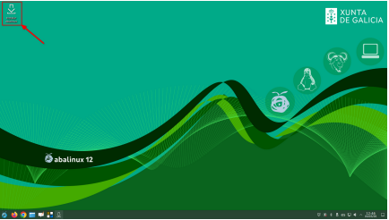
* **5.º paso:** Si el equipo tuviera algún disco con un volumen lógico ver el [apartado 1.1](#11-nota-para-equipos-con-lvm).
* **6.º paso:** Seleccionamos el idioma o dejamos el que viene por defecto. Pulsamos en **Siguiente**.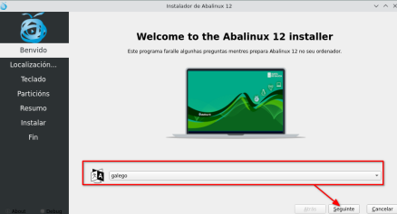
* **7.º paso:** Seleccionamos la localización o dejamos la que viene por defecto. Pulsamos en **Siguiente**.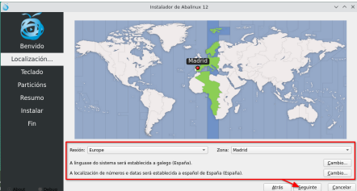
* **8.º paso:** Seleccionamos la distribución del teclado o dejamos la que viene por defecto. Pulsamos en **Siguiente**.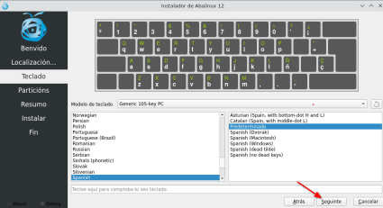
* **9.º paso:** Seleccionamos **Borrar disco**. Si el equipo solo tiene un disco podemos pulsar en **Siguiente** sin problema; si tiene más de uno deberemos escoger en cuál queremos instalar el sistema en el apartado *Seleccione el dispositivo de almacenamiento*.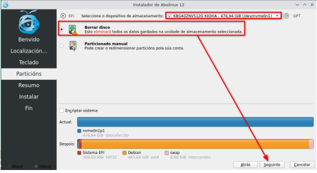
* **10.º paso:** Se muestra un resumen de las opciones escogidas. Pulsamos en **Instalar** y comienza el proceso de instalación.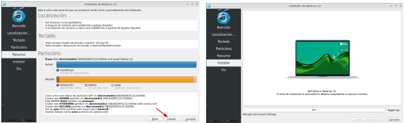
* **11.º paso:** La instalación finaliza, pulsamos en **Aceptar** y el equipo se reinicia automáticamente.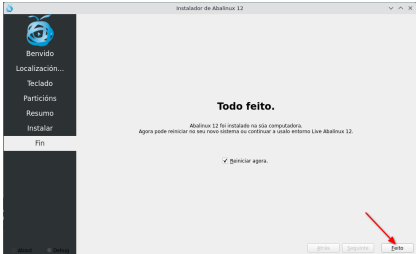

---

### 1.1 NOTA PARA EQUIPOS CON LVM

Para realizar la instalación con éxito deberemos eliminar los posibles volúmenes lógicos que existan en el disco donde se va a instalar el sistema. Para esto el instalador abalar realizará una comprobación previa que ofrecerá la posibilidad de eliminar estos volúmenes en el caso de existir.
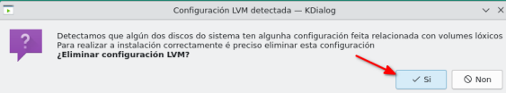

*Hay que tener en cuenta que si aceptamos la eliminación de estos volúmenes eliminaremos los datos del disco aunque después no instalemos el sistema.*
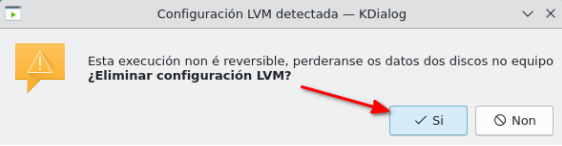

---

### 1.2 NOTA PARA EQUIPOS ACER TRAVELMATE P259-G2-M

Estos equipos vienen con 2 discos duros: uno es un HDD de 1TB y el otro un disco SSD que puede ser NVMe o SATA.

En el caso de ser un SSD SATA, el sistema identifica como disco principal el de 1TB mientras que en la BIOS el disco de arranque es el SSD, por lo que tendremos que revisar lo indicado en el **paso 8** y escoger el disco de menor capacidad.

Y además tiene otra particularidad este equipo: a veces los USB arrancan en modo **Legacy** y otras en modo **UEFI**. Cuando arranca en modo Legacy tendremos que tener cuidado y seleccionar en el apartado de *Localización del cargador de arranque* el mismo disco (`sdb`) para que el equipo pueda arrancar sin problemas.
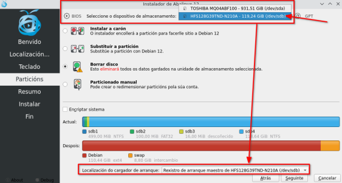

Para los equipos con disco NVMe ya se selecciona automáticamente este disco, por lo que podremos pulsar en **Siguiente** sin hacer ninguna otra modificación.

---

## 2. <u>INSTALACIÓN PERSONALIZADA</u>

Este proceso consiste en una instalación del sistema operativo en varias particiones.

> **Advertencia:** Todos los datos almacenados en el dispositivo serán eliminados y no podrán ser recuperados.

> **Nota:** Si el equipo tuviera algún disco con un volumen lógico ver el [apartado 1.1](#11-nota-para-equipos-con-lvm).

Procedemos igual que en la instalación simple hasta el **paso 8**, pero escogemos **Particionado Manual** y eliminamos las particiones existentes.

---

### 2.1 EQUIPOS BIOS

1. Creamos una nueva tabla de particiones **MBR**.
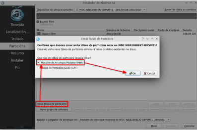
2. Realizamos el particionado que queramos:
   * **Partición para `/boot`:** 512 MB (sistema de archivos `ext2`).
   * **Partición raíz `/`:** Tamaño deseado (ej. 80 GB, sistema de archivos `ext4`).
   * **Partición para `/home`:** Tamaño deseado (ej. resto del disco, sistema de archivos `ext4`).
   * **Partición para Swap:** Tamaño deseado (ej. 8 GB, sistema de archivos `linuxswap`).
3. Seleccionamos el disco donde queremos que se instale el cargador de arranque, normalmente `/dev/sda`, y pulsamos en **Siguiente**.
4. *(Si salta un aviso de que también podríamos utilizar una tabla de particiones GPT, lo ignoramos).*
5. Se muestra un resumen de las configuraciones escogidas. Pulsamos en **Instalar** y esperamos a que termine la instalación.
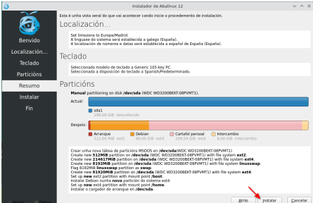

---

### 2.2 EQUIPOS UEFI

1. Creamos una tabla de particiones **GPT**.
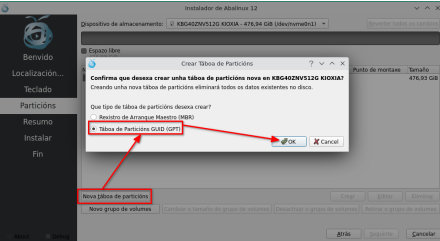
2. Realizamos el particionado que queramos (en este caso vamos a seguir las recomendaciones del Anexo I):
   * **Partición EFI:** 512 MB de tamaño, formato `fat32`, punto de montaje `/boot/efi`. Hay que asegurarse de marcar la opción/bandera de **arranque** (`boot`).
   * **Partición raíz `/`:** Tamaño deseado (ej. 100 GB, sistema de archivos `ext4`).
   * **Partición para `/home`:** Tamaño deseado (ej. resto del disco, sistema de archivos `ext4`).
   * **Partición para Swap:** Tamaño deseado (ej. 8 GB, sistema de archivos `linuxswap`).
3. Una vez que terminamos de crear las particiones pulsamos en **Siguiente**.
4. Se muestra un resumen de las opciones escogidas. Pulsamos en **Instalar** y esperamos a que termine el proceso de instalación.
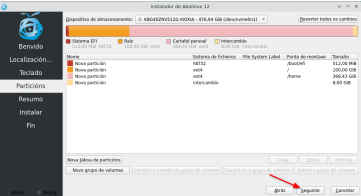
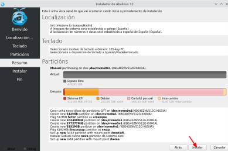

---

### 2.3 EQUIPOS ACER TRAVELMATE P259-G2-M

Estos equipos tienen por defecto configurado el arranque en modo Legacy desde la BIOS, por lo que se espera que exista una instalación del sistema que atienda a este hecho; pero tiene un comportamiento aleatorio en cuanto inicias un LiveUSB (tanto hecho por medio de `dd` como de Ventoy), en el que el sistema puede arrancar en cualquiera de los dos modos.

Además, este equipo tiene dos discos: un SSD (SATA o NVMe) y un HDD de mayor tamaño, que aprovecharemos para montar el directorio `/home`.

> **Nota:** Hay que asegurarse de escoger el disco de menor capacidad para instalar el arranque.

#### 2.3.1 LiveUSB en modo BIOS

1. Llegamos al apartado de selección de disco y veremos que identifica el sistema como **BIOS**.
2. Escogemos **Particionado manual**.
3. Borramos las particiones de los dos discos y nos aseguramos de dejar marcado el disco correcto en el apartado del *Cargador de arranque*.
4. Una vez eliminadas todas las particiones, procedemos a crear una tabla de particiones MBR en los discos siguiendo el punto 2.1.
5. En el disco SSD (el de menor capacidad), instalaremos el sistema operativo: particiones `/boot`, `/` y `swap`.
6. En el disco de 1TB, creamos e instalamos la partición `/home`.
7. Nos aseguramos de escoger el disco SSD para instalar el cargador de arranque.
8. Finalmente se muestra el resumen de las configuraciones hechas, pulsamos en **Instalar** y esperamos a que termine el proceso.

#### 2.3.2 LiveUSB en modo UEFI

1. Llegamos al apartado de selección de disco y veremos que identifica el sistema como **EFI**.
2. Escogemos **Particionado manual** y borramos las particiones de los dos discos.
3. Procedemos a crear una tabla de particiones GPT en los discos siguiendo lo indicado en el punto 2.2.
4. En el disco SSD (el de menor capacidad), creamos las particiones `/boot/efi`, `/` y `swap`.
5. En el disco de 1TB, creamos la partición `/home`.
6. Finalmente se muestra el resumen de las configuraciones hechas, pulsamos en **Instalar** y esperamos a que termine el proceso.

---

## 3. <u>INSTALACIÓN CON ARRANQUE DUAL</u>

Si tenemos un equipo con un sistema operativo instalado (por ejemplo Windows) y queremos instalar Abalinux 12 a su lado para poder escoger en el arranque entre un sistema u otro, procederemos del siguiente modo:

1. Iniciamos la instalación siguiendo los pasos indicados en el punto 1 hasta el **paso 8**.
2. Ahí escogeremos **Instalar al lado**.
3. Seleccionamos con el ratón las particiones actuales y al momento aparecerá abajo un control deslizante que nos permitirá escoger el tamaño que le queremos asignar a Abalinux 12.
4. Una vez definido, pulsamos en **Siguiente**.
5. A continuación se muestra un resumen con las opciones escogidas. Pulsamos en **Instalar** y comenzará el proceso de instalación del sistema al lado del que ya teníamos en el equipo.
6. Una vez terminado podremos reiniciar el equipo y escoger con qué sistema operativo queremos trabajar.

---

## 4. <u>CREAR MEDIO DE INSTALACIÓN CON VENTOY</u>

El software **Ventoy** viene instalado por defecto en las últimas versiones de Abalinux y también en las maquetas gestionadas de los centros educativos. Podremos encontrarlo en el apartado de **Sistema**.
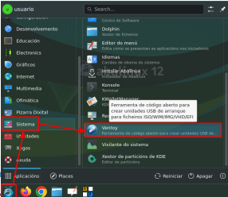

*En el caso de que no dispongamos del software en nuestro sistema, podremos descargarlo desde su página oficial (https://www.ventoy.net/en/download.html)(existen versiones tanto para Linux como para Windows).

### Pasos para preparar el USB:

1. Antes de ejecutar Ventoy, introducimos el USB que queremos utilizar como medio de instalación.
2. Ejecutamos Ventoy y seleccionamos el USB correcto.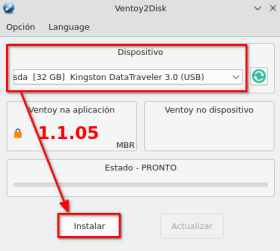
3. Pulsamos en **Instalar** y aceptamos la doble verificación que se nos muestra (avisándonos de que en el proceso se van a perder todos los datos del dispositivo).

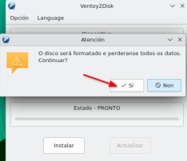
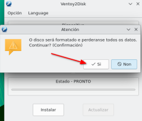

4. Esperamos a que el proceso finalice.
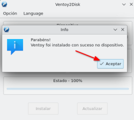
5. Ahora podremos usar este USB para copiar dentro los archivos de imagen que queramos (añadimos la ISO de Abalinux 12 que previamente hemos descargado).

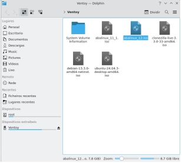

### Pasos para arrancar desde el USB:

1. Introducimos el USB en el equipo donde queremos instalar el sistema.
2. Encendemos el equipo y pulsamos repetidamente la tecla que da acceso al menú de boot (puede variar según el modelo, pero por lo general suelen ser **F9** o **F12**).
3. Escogemos el USB introducido y pulsamos **Enter**.
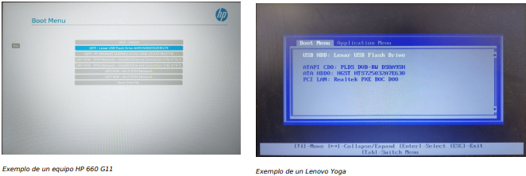
4. Se inicia Ventoy y nos muestra un menú donde podremos escoger cualquiera de los archivos ISO guardados. Escogemos el de Abalinux y pulsamos **Enter**.

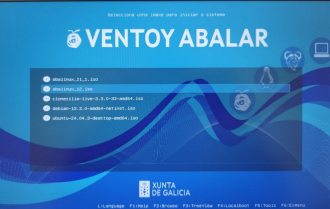

5. A continuación escogemos la opción por defecto **Boot in normal mode** y luego la entrada de **Abalinux** para iniciar el entorno Live que nos permitirá instalar el sistema.
6. A partir de aquí seguimos los pasos indicados en: [Instalación Fácil](#1-instalación-fácil)

> **Incidencia ocasional:** En algunos modelos puede aparecer una pantalla distorsionada en la que no se distingue nada; para estos casos escogeremos la opción **Boot in grub2 mode**.

---

---

